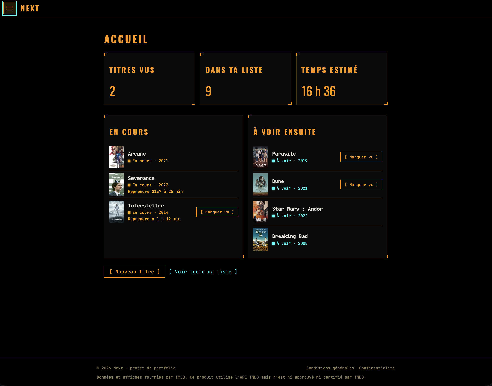
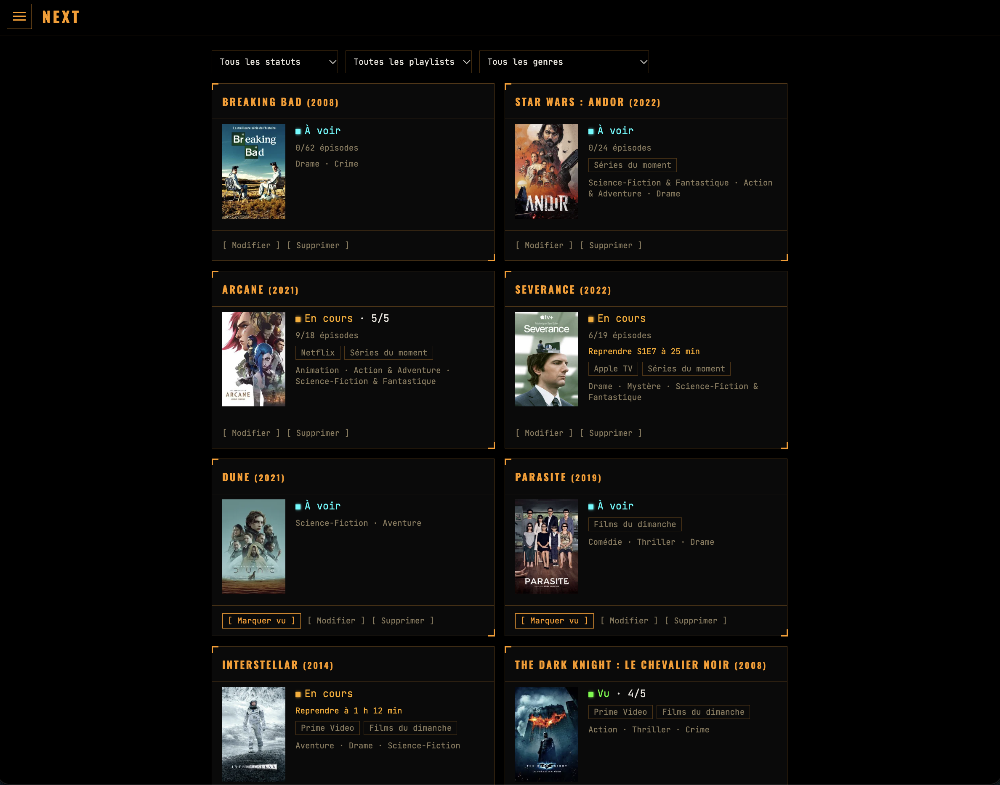
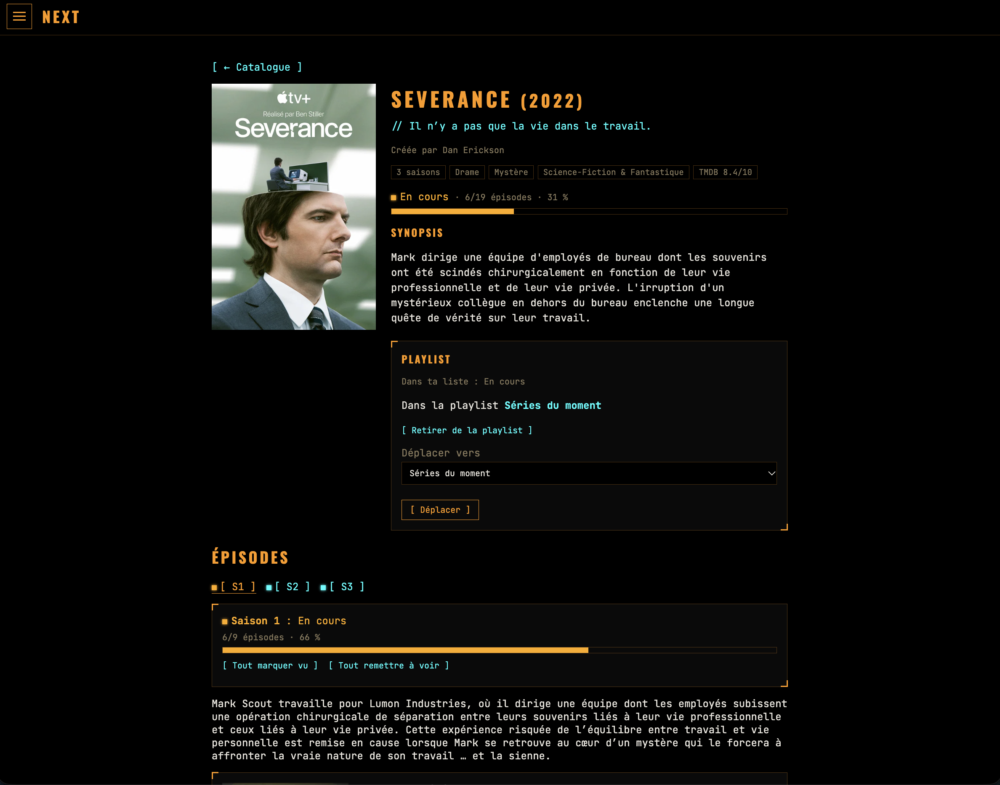
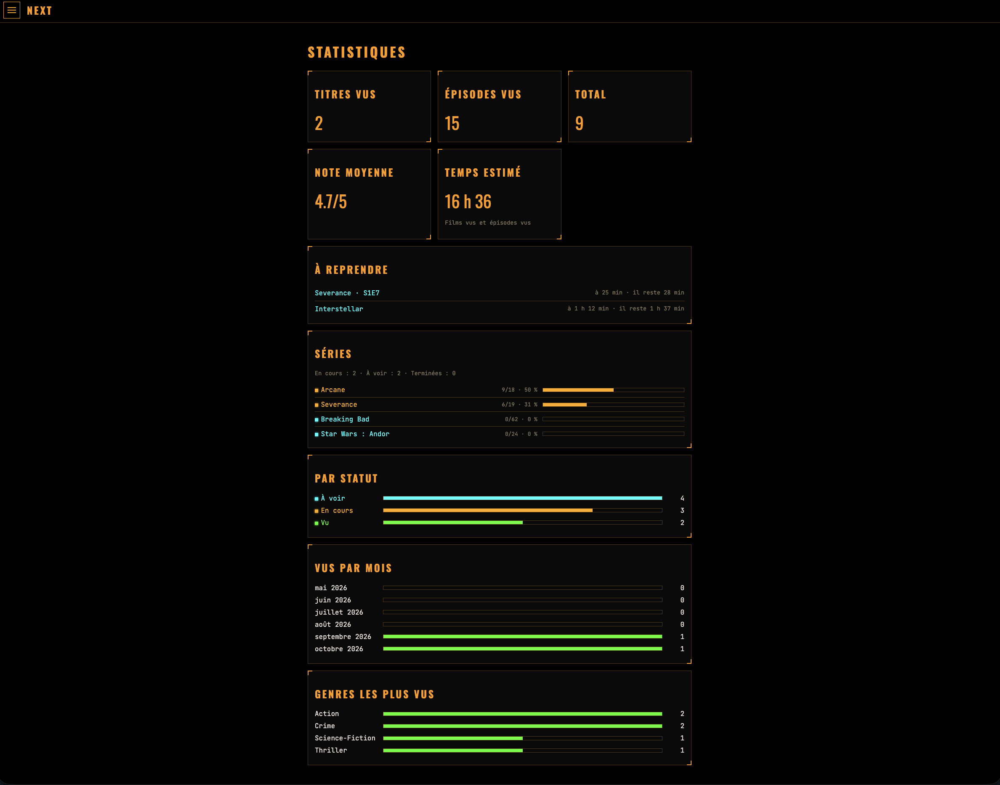
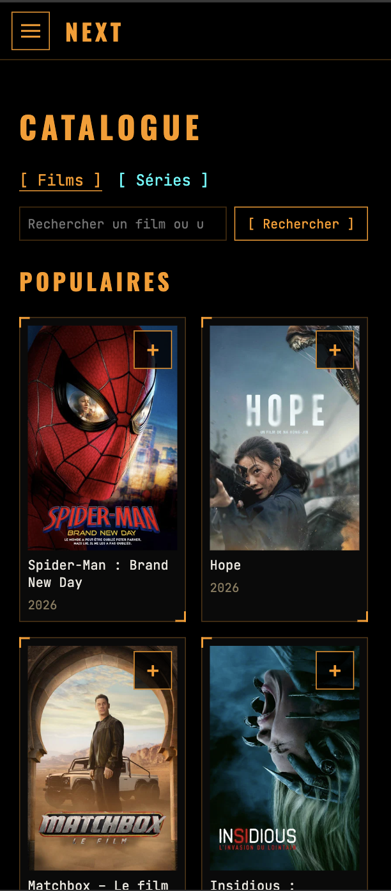

# Next

> // For everything that shouldn't be forgotten

A movie and TV watchlist: statuses, ratings, playlists, episode-by-episode progress, resume position and statistics. Bilingual interface (French and English), with a visual identity inspired by command terminals.

**[Live demo: next.tremic.fr](https://next.tremic.fr)** · click "Try without an account", no sign-up

| Home | My list |
| --- | --- |
|  |  |

| A series page | Statistics |
| --- | --- |
|  |  |



## Features

- **Catalog** of movies and TV shows (TMDB API): search, pagination, one-click add to an existing or new playlist from a modal
- **Detail pages**: synopsis, cast, crew; for a series, seasons and episodes with their synopsis, guests and crew
- **Progress tracking**: every episode is "to watch", "in progress" or "watched"; the state and the completion percentage of each season and of the series are derived automatically ("Series finished" once every season is watched)
- **Resume position** in hours, minutes and seconds for a movie or an episode, shown as "Resume at 42 min" in the lists
- **Playlists**: one page per playlist, with the same cards and filters as "My list"
- **Live filters** by status, playlist and genre, with no server request
- **Statistics**: estimated watch time, episodes watched, progress of each series, titles to resume, watched per month, most watched genres
- **Side menu** that floats over the content without pushing it, usable with the keyboard
- **French and English**: notifications, error messages, legal pages and TMDB synopses follow the chosen language; for a signed-in account the language is saved and follows the user across devices
- **Settings**: language and account deletion, with a confirmation
- **Strong passwords**: at least 8 characters, a lowercase letter, an uppercase letter, a digit and a special character, with the rules listed under the field and one error per missing rule
- **Shared demo account**, automatically reset every hour and protected against any change
- **Legal pages** (terms, privacy) and a privacy notice with no consent banner: only strictly necessary cookies are used

## Stack

| Layer | Technologies |
| --- | --- |
| Backend | Ruby 3.3, Rails 8.1, SQLite, Devise, Pundit, Solid Queue and Solid Cache |
| Frontend | Hotwire (Turbo, Stimulus), Vite, custom CSS, native HTML elements (`<dialog>`, `<details>`) |
| External data | TMDB API, with caching and error handling |
| Quality | Minitest (300+ tests), Rubocop, GitHub Actions, protected `main` branch |
| Deployment | Docker, Kamal, VPS, Nginx and Certbot |

## Technical choices

- **Hotwire rather than a JavaScript framework.** I first planned Vue for the dashboard, then removed it: Stimulus and Rails are enough, and a second framework would only have been there to tick a box. Every interaction (autocomplete, filters, modals, notifications, menu) is a small Stimulus controller.
- **Explicit authorization with Pundit.** Everything is denied by default, and a safety net (`verify_authorized`) fails any action that forgets to authorize. A user can neither read nor modify another user's data, even with a forged request, and tests check it.
- **Business logic in plain objects.** TMDB calls (`Tmdb::Client`, `Catalog`, `TitleDetails`, `SeasonDetails`), progress states (`SeriesProgress`), tracking (`SeriesTracker`, in a transaction), the demo reset (`Demo::Reset`) and statistics (`Stats::Dashboard`) are classes tested in isolation with fake clients: no test hits the network.
- **TMDB under control.** Explicit timeouts, a single error class, responses cached for six hours (the language is part of the key), and a TMDB outage never prevents saving a title. Runtimes and ids come from the server, never from the browser.
- **Language chosen in a Rack middleware**, placed before Warden: the messages Devise produces outside controllers ("sign in to continue") are translated too. Tests check that the French and English files have the same keys and that no text is left hard-coded in a view or a controller.
- **Password rules in a dedicated validator**, applied only when a password is entered: existing accounts and the demo account are not affected. Length is capped at 72 characters, since bcrypt ignores the rest.
- **Accessibility.** Visible focus outline, `aria-label`, `aria-pressed` and `aria-describedby`, native elements rather than custom components, a single tab stop per card, the rest of the page made inert while the menu or a modal is open, `prefers-reduced-motion` respected.
- **A design system of its own.** Palette, typefaces, corner brackets and LED status indicators are defined once in a stylesheet, with no component library.

## What I learned along the way

- Since Rails 7.1, a callback limited with `only: :index` raises an error when a controller has no such action: Devise's sign-out returned a 404. A five-line test caught it before production.
- With parallel tests, Vite's automatic build produced an empty manifest. The build now runs once before the suite, locally and in CI.
- In SQL, `media_type != 'tv'` does not return rows where `media_type` is `NULL`. Titles typed by hand were missing from the statistics.
- A Devise module (`recoverable`) with no mail delivery configured is a button that does nothing: I removed it rather than let it mislead visitors.
- A menu that pushes the content when it opens is a layout bug, not a detail: it now floats over the page.

## Running it locally

Requirements: Ruby 3.3, Node 20 or later, and a free TMDB "API Read Access Token" from [TMDB](https://www.themoviedb.org/settings/api).

```bash
git clone https://github.com/mtremauville/next_app.git
cd next_app
bundle install
npm install
export TMDB_API_KEY=your_token
bin/rails db:setup
bin/dev
```

The app runs at http://localhost:3000. To fill the demo account: `bin/rails demo:reset`.

## Tests

```bash
bundle exec rubocop
RAILS_ENV=test bin/vite build && bin/rails test
```

CI runs the same commands on every pull request to `dev` or `main`.

## Deployment

The app is packaged as a Docker image and deployed with [Kamal](https://kamal-deploy.org) on a VPS. Nginx acts as the reverse proxy and terminates TLS (Certbot). The SQLite database lives on a persistent volume, and background jobs (including the demo reset) run inside the app process with Solid Queue. No secret is committed: keys come from the environment and from Rails' encrypted credentials.

## Roadmap

- Mood-based recommendations and "what to watch next", using an LLM (`ruby_llm`)
- Search by genre, actor and director
- A light mode, besides the dark theme
- Sign in with a Google account
- Store TMDB genre ids, so the genre filter does not depend on the language a title was added in
- A separate guest account per visitor instead of a shared one
- Email delivery, and with it password reset
- Several playlists per title
- Books, music and video games

## Credits

Data and posters provided by [TMDB](https://www.themoviedb.org). This product uses the TMDB API but is not endorsed or certified by TMDB.

## About

I'm Mickael, a junior developer (frontend or fullstack Rails) trained at the Le Wagon bootcamp. Next is my portfolio project: I'm looking for a role where I can put it to work.
[LinkedIn](https://www.linkedin.com/in/mickaeltremauville) · [Blog](https://tremic.fr) · mickael.tremauville@gmail.com
Icons: [Font Awesome Free](https://fontawesome.com) (CC BY 4.0 license).
